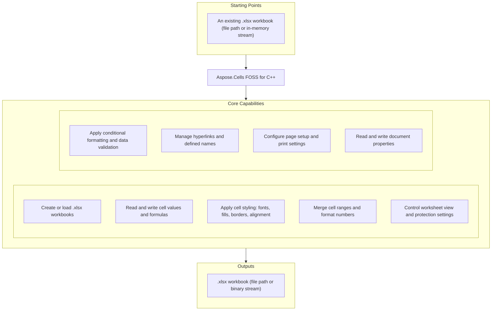

# Aspose.Cells FOSS for C++

[](https://www.nuget.org/packages/Aspose.Cells.Cpp.FOSS/) [](https://github.com/aspose-cells-foss/Aspose.Cells-FOSS-for-Cpp/blob/main/License/LICENSE.txt) [](https://github.com/aspose-cells-foss/Aspose.Cells-FOSS-for-Cpp/graphs/contributors) [](https://github.com/aspose-cells-foss/Aspose.Cells-FOSS-for-Cpp/issues)

[](https://products.aspose.org/cells/cpp/)

Aspose.Cells FOSS for C++ is a free, open-source, MIT-licensed C++ library for creating, loading,
editing, and saving Excel `.xlsx` workbooks without requiring Microsoft Excel. It exposes an
Aspose.Cells-compatible API surface for common XLSX scenarios — the same `Workbook`, `Worksheet`,
and `Cell` object shape used by Aspose's commercial spreadsheet products — built as a
dependency-free, header-and-source C++17 library with no external runtime dependencies.

## Navigation

- [At a Glance](#at-a-glance)
- [Key Capabilities](#key-capabilities)
- [Installation](#installation)
- [Quick Start](#quick-start)
- [Additional Examples](#additional-examples)
- [API Reference](#api-reference)
- [Documentation & Resources](#documentation--resources)
- [Scope and Limitations](#scope-and-limitations)
- [Development and Testing](#development-and-testing)
- [License](#license)

## At a Glance



## Key Capabilities

- **Create or load `.xlsx` workbooks**: construct a blank `Workbook`, or load an existing file
  from a path or an in-memory `std::vector<std::uint8_t>` stream via one of `Workbook`'s
  constructors, then save back out to either form with `Workbook.Save()`.
- **Read and write cell values and formulas**: `Cell.PutValue()` accepts strings, integers,
  doubles, bools, and `DateTime`; `Cell.GetValue()` returns a variant-typed `CellValue`, and
  `Cell.SetFormula()`/`Cell.GetFormula()` handle Excel formula text with or without a leading `=`.
- **Apply cell styles**: `Cell.GetStyle()`/`Cell.SetStyle()` return and apply a `Style`, which
  bundles `Font` (bold, color), fill (`FillPattern`, foreground/background `Color`), `Borders`,
  alignment, and text wrap into one cloneable value.
- **Merge cell ranges and apply number formats**: `Cells.Merge()` creates merged regions tracked
  as `MergeRegion`s, and `Style.SetNumberFormat()`/`NumberFormat` apply and parse Excel
  display-format patterns, rendered through `DisplayTextFormatter` with locale-directive support.
- **Control worksheet view and protection settings**: per-sheet `VisibilityType` (visible, hidden,
  very hidden), zoom, gridline and header visibility, right-to-left (RTL) layout, and
  `WorksheetProtection` are all exposed directly on `Worksheet`.
- **Apply conditional formatting and data validation**: `Worksheet.GetConditionalFormattings()`
  manages rule-driven cell formatting through `FormatCondition`, and
  `Worksheet.GetValidations()` manages input constraints through `Validation`, both scoped to
  one or more `CellArea` ranges.
- **Manage hyperlinks and defined names**: `Worksheet.GetHyperlinks()` attaches external, internal,
  or `mailto:` links to a cell range via `Hyperlink`, and `Workbook.GetDefinedNames()` manages
  workbook- or sheet-scoped named ranges through `DefinedNameCollection`, each of which can carry
  its own descriptive comment string.
- **Configure page setup and print settings**: `Worksheet.GetPageSetup()` returns a `PageSetup` for
  paper size, orientation, margins, scaling, print area/titles, headers/footers, and page breaks.
- **Read and write document properties**: `Workbook.GetProperties()` and
  `Workbook.GetDocumentProperties()` expose core and extended metadata through
  `WorkbookProperties`/`DocumentProperties`.

## Installation

Aspose.Cells FOSS for C++ is published on NuGet as `Aspose.Cells.Cpp.FOSS`, but the package
ships prebuilt static libraries for **Windows only** (`lib/win_x86`, `lib/win_x86_64`) built with
the MSVC `v14x` toolset — its own bundled `aspose.cells.cpp.foss.targets` file errors the build
for any other toolset or platform. There are no Linux/macOS binaries in the package.

```bash
nuget install Aspose.Cells.Cpp.FOSS
```

In an MSBuild-based Visual Studio project:

```xml
<PackageReference Include="Aspose.Cells.Cpp.FOSS" Version="26.4.1" />
```

Or in a CMake project on Windows, point at the package's own bundled config, which defines an
`Aspose.Cells.Cpp.FOSS` imported target:

```cmake
set(aspose.cells.cpp.foss_DIR "path/to/packages/Aspose.Cells.Cpp.FOSS.26.4.1/build/native/Aspose.Cells.Cpp.FOSS")
find_package(aspose.cells.cpp.foss CONFIG REQUIRED)
target_link_libraries(your_target PRIVATE Aspose.Cells.Cpp.FOSS)
```

On Linux, macOS, or with a non-MSVC toolchain, build from source instead — the library itself is
a plain, dependency-free CMake target and targets C++17 on MSVC, GCC, and Clang alike:

```cmake
add_subdirectory(Aspose.Cells.Foss.Cpp)
target_link_libraries(your_target PRIVATE aspose_cells_foss)
```

## Quick Start

Create a workbook, populate cells with values and a formula, apply header styling, and save:

```cpp
#include "aspose/cells_foss/Workbook.h"
#include "aspose/cells_foss/WorksheetCollection.h"
#include "aspose/cells_foss/Worksheet.h"
#include "aspose/cells_foss/Cell.h"
#include "aspose/cells_foss/Style.h"
#include "aspose/cells_foss/Color.h"
#include "aspose/cells_foss/Font.h"

using namespace Aspose::Cells_FOSS;

int main() {
    Workbook workbook;
    Worksheet& sheet = workbook.GetWorksheets()[0];

    sheet.SetName("Products");
    sheet.GetCells()["A1"].PutValue("Product");
    sheet.GetCells()["B1"].PutValue("Price");
    sheet.GetCells()["A2"].PutValue("Apple");
    sheet.GetCells()["B2"].PutValue(2.99);
    sheet.GetCells()["A3"].PutValue("Orange");
    sheet.GetCells()["B3"].PutValue(1.99);
    sheet.GetCells()["B4"].SetFormula("=SUM(B2:B3)");

    Style headerStyle = sheet.GetCells()["A1"].GetStyle();
    Font font;
    font.SetBold(true);
    font.SetColor(Color::FromArgb(255, 255, 255, 255));
    headerStyle.SetFont(font);
    headerStyle.SetPattern(FillPattern::Solid);
    headerStyle.SetForegroundColor(Color::FromArgb(255, 34, 120, 212));
    sheet.GetCells()["A1"].SetStyle(headerStyle);
    sheet.GetCells()["B1"].SetStyle(headerStyle);

    workbook.Save("products.xlsx");
    return 0;
}
```

## Additional Examples

More real, grounded snippets are collected below.

### Load an Existing Workbook and Read Cells

```cpp
#include "aspose/cells_foss/Workbook.h"
#include "aspose/cells_foss/Worksheet.h"
#include "aspose/cells_foss/Cell.h"

using namespace Aspose::Cells_FOSS;

Workbook workbook("products.xlsx");
Worksheet& sheet = workbook.GetWorksheets()["Products"];

std::string name = sheet.GetCells()["A2"].GetStringValue();
double price = sheet.GetCells()["B2"].GetValue().AsDouble();
std::string total = sheet.GetCells()["B4"].GetDisplayStringValue();  // formatted formula result
```

`Workbook` also has a constructor that loads from an in-memory
`std::vector<std::uint8_t>` stream instead of a file path, for scenarios that read the source
bytes from somewhere other than the filesystem.

<details>
<summary>View Additional Examples</summary>

### Highlight Cells With Conditional Formatting

```cpp
auto& formattings = sheet.GetConditionalFormattings();
auto collection = formattings[formattings.Add()];
collection.AddArea(CellArea::CreateCellArea("A1", "A3"));

auto condition = collection[collection.AddCondition(
    FormatConditionType::CellValue, OperatorType::Between, "=1", "=9")];
condition.SetPriority(1);

Style style = condition.GetStyle();
style.SetPattern(FillPattern::Solid);
style.SetForegroundColor(Color::FromArgb(255, 255, 0, 0));
condition.SetStyle(style);
```

### Constrain Input With Data Validation

```cpp
auto& validations = sheet.GetValidations();
auto rule = validations[validations.Add(CellArea::CreateCellArea("A1", "B2"))];

rule.SetType(ValidationType::WholeNumber);
rule.SetOperator(OperatorType::Between);
rule.SetFormula1("=1");
rule.SetFormula2("=10");
rule.SetShowError(true);
rule.SetErrorTitle("Whole Number");
rule.SetErrorMessage("Enter 1-10");
```

### Add a Hyperlink

```cpp
sheet.GetCells()["A1"].PutValue("Docs");
auto& hyperlinks = sheet.GetHyperlinks();
auto link = hyperlinks[hyperlinks.Add("A1", 1, 1, "https://docs.aspose.org/cells/cpp/")];
link.SetTextToDisplay("Docs");
link.SetScreenTip("Getting started guide");
```

### Configure Page Setup for Printing

```cpp
PageSetup& pageSetup = sheet.GetPageSetup();
pageSetup.SetOrientation(PageOrientationType::Landscape);
pageSetup.SetPaperSize(PaperSizeType::PaperA4);
pageSetup.SetFitToPagesWide(1);
pageSetup.SetPrintArea("$A$1:$D$20");
pageSetup.SetPrintTitleRows("$1:$2");
pageSetup.SetCenterFooter("Page &P of &N");
```

### Define a Named Range

```cpp
int index = workbook.GetDefinedNames().Add("PriceRange", "=Products!$B$2:$B$3");
DefinedName priceRange = workbook.GetDefinedNames()[index];
priceRange.SetComment("Cell range used by the SUM formula in B4.");
```

</details>

## API Reference

The library's public types live in the `Aspose::Cells_FOSS` namespace, with `Workbook` as the
root entry point and `Worksheet`/`Cells`/`Cell` forming the primary object graph beneath it. The
full public surface — 197 public types — is listed below, grouped exactly as
`reference.aspose.org` organizes them.

<details>
<summary>View the Supported Public API Surface</summary>

### Core API

| Class | Description |
|---|---|
| `AlignmentValue` | Represents alignment value. |
| `AutoFilter` | Represents auto filter. |
| `AutoFilterColorFilter` | Represents auto filter color filter. |
| `AutoFilterColorFilterModel` | Represents auto filter color filter model. |
| `AutoFilterCustomFilter` | Represents auto filter custom filter. |
| `AutoFilterCustomFilterCollection` | Represents a collection of auto filter custom filter objects. |
| `AutoFilterCustomFilterCollection_Iterator` | Class in the Cells CPP API. |
| `AutoFilterCustomFilterModel` | Represents auto filter custom filter model. |
| `AutoFilterDynamicFilter` | Represents auto filter dynamic filter. |
| `AutoFilterDynamicFilterModel` | Represents auto filter dynamic filter model. |
| `AutoFilterModel` | Represents auto filter model. |
| `AutoFilterSortCondition` | Represents auto filter sort condition. |
| `AutoFilterSortConditionCollection` | Represents a collection of auto filter sort condition objects. |
| `AutoFilterSortConditionCollection_Iterator` | Class in the Cells CPP API. |
| `AutoFilterSortConditionModel` | Represents auto filter sort condition model. |
| `AutoFilterSortState` | Represents auto filter sort state. |
| `AutoFilterSortStateModel` | Represents auto filter sort state model. |
| `AutoFilterSupport` | Internal helper methods for auto-filter operations. |
| `AutoFilterTop10` | Represents auto filter top10. |
| `AutoFilterTop10Model` | Represents auto filter top10 model. |
| `BitReader` | Internal bit-level reader used while inflating DEFLATE-compressed ZIP entry data. |
| `Border` | Represents border. |
| `BorderSideValue` | Represents border side value. |
| `Borders` | Represents borders. |
| `BordersValue` | Represents borders value. |
| `CalculationProperties` | Represents calculation properties. |
| `CalculationPropertiesModel` | Represents calculation properties model. |
| `Cell` | Represents a single worksheet cell and exposes value, formula, and style operations. |
| `CellAddress` | Represents cell address. |
| `CellArea` | Represents cell area. |
| `CellFormatValue` | Represents cell format value. |
| `CellRecord` | Represents cell record. |
| `CellValue` | Variant-typed scalar cell value wrapper over `monostate`/`int`/`double`/`bool`/`std::string`/`DateTime`. |
| `Cells` | Provides access to worksheet cells, rows, columns, and merged ranges. |
| `CellsException` | Represents an error that occurs during cells. |
| `Column` | Represents column. |
| `ColumnCollection` | Represents a collection of column objects. |
| `ColumnRangeModel` | Represents column range model. |
| `ConditionalFormattingCollection` | Represents a collection of conditional formatting objects. |
| `ConditionalFormattingModel` | Represents conditional formatting model. |
| `CoreDocumentProperties` | Represents core document properties. |
| `CoreDocumentPropertiesModel` | Represents core document properties model. |
| `DateSerialConverter` | Provides date serial converter operations. |
| `DateTime` | DateTime provides component accessors such as GetYear(), GetMonth(), GetDay(), GetHour(), GetMinute(), and GetSecond() to retrieve individual parts of a date‑time value. |
| `DefinedName` | Represents defined name. |
| `DefinedNameCollection` | Represents a collection of defined name objects. |
| `DefinedNameModel` | Represents defined name model. |
| `DefinedNameUtility` | Provides normalization and validation helpers for defined names. |
| `DiagnosticBag` | Represents diagnostic bag. |
| `DiagnosticEntry` | Represents diagnostic entry. |
| `DisplayFormatSectionInfo` | Represents display format section info. |
| `DisplayTextDateFormatSupport` | Internal helper methods for formatting date/time display text. |
| `DisplayTextFormatter` | Internal static helper for formatting display text of cell values. |
| `DisplayTextFormatterSupport` | Internal helper methods for display-text formatting of numeric, text, and date/time values. |
| `DisplayTextLocaleSupport` | Internal helper for parsing and applying locale directives (e.g. `[$-0409]`, `[$-F800]`) embedded in Excel format strings. |
| `DocumentProperties` | Represents document properties. |
| `DocumentPropertiesModel` | Represents document properties model. |
| `ExtendedDocumentProperties` | Represents extended document properties. |
| `ExtendedDocumentPropertiesModel` | Represents extended document properties model. |
| `FillValue` | Represents fill value. |
| `FilterColumn` | Represents filter column. |
| `FilterColumnCollection` | Represents a collection of filter column objects. |
| `FilterColumnCollection_Iterator` | Class in the Cells CPP API. |
| `FilterColumnModel` | Represents filter column model. |
| `FilterValueCollection` | Represents a collection of filter value objects. |
| `Font` | Represents font. |
| `FontValue` | Represents font value. |
| `FormatCondition` | Represents format condition. |
| `FormatConditionCollection` | Represents a collection of format condition objects. |
| `FormatConditionModel` | Represents format condition model. |
| `FormulaException` | Represents an error that occurs during formula. |
| `HeaderFooterModel` | Represents header footer model. |
| `Hyperlink` | Represents hyperlink. |
| `HyperlinkCollection` | Encapsulates the hyperlinks defined for a worksheet. |
| `HyperlinkModel` | Represents hyperlink model. |
| `InvalidFileFormatException` | Represents an error that occurs during invalid file format. |
| `LoadDiagnostics` | Represents load diagnostics. |
| `LoadIssue` | Represents load issue. |
| `LoadOptions` | Specifies how a workbook should be loaded. |
| `MergeRegion` | Represents merge region. |
| `MissingPartException` | Represents an error that occurs during missing part. |
| `NumberFormat` | Provides number format operations. |
| `NumberFormatValue` | Represents number format value. |
| `PackageLoadContext` | Represents package load context. |
| `PackageModel` | Represents package model. |
| `PackagePartDescriptor` | Represents package part descriptor. |
| `PackageStructureException` | Represents an error that occurs during package structure. |
| `PackagingConventions` | Provides packaging conventions operations. |
| `PageMarginsModel` | Represents page margins model. |
| `PageSetup` | Represents worksheet print and page-layout settings. |
| `PageSetupModel` | Represents page setup model. |
| `PrintOptionsModel` | Represents print options model. |
| `ProtectionValue` | Represents protection value. |
| `RelationshipDescriptor` | Represents relationship descriptor. |
| `RelationshipResolutionException` | Represents an error that occurs during relationship resolution. |
| `Row` | Represents row. |
| `RowCollection` | Represents a collection of row objects. |
| `RowModel` | Represents row model. |
| `SaveOptions` | Specifies how a workbook should be saved. |
| `SharedStringRepository` | Represents shared string repository. |
| `SharedStringTableXmlMapper` | Represents shared string table xml mapper. |
| `Style` | Represents a mutable cell style facade that can be applied to one or more cells. |
| `StyleException` | Represents an error that occurs during style. |
| `StyleRepository` | Represents style repository. |
| `StyleValue` | Represents style value. |
| `StyleValueSanitizer` | Provides normalization helpers for style integer values. |
| `StylesheetLoadContext` | Internal context used during stylesheet loading to accumulate cell formats, differential formats, date style indexes, and the default cell style. |
| `StylesheetSaveContext` | Internal context used during stylesheet saving to hold the built stylesheet document together with style index maps and format counts. |
| `StylesheetXmlMapper` | Represents stylesheet xml mapper. |
| `UnsupportedFeatureException` | Represents an error that occurs during unsupported feature. |
| `Validation` | Represents validation. |
| `ValidationCollection` | Represents a collection of validation objects. |
| `ValidationMessage` | Represents validation message. |
| `ValidationModel` | Represents validation model. |
| `WarningInfo` | Represents warning info. |
| `Workbook` | Represents the root spreadsheet object used to create, load, modify, and save an XLSX workbook. |
| `WorkbookLoadException` | Represents an error that occurs during workbook load. |
| `WorkbookModel` | Represents workbook model. |
| `WorkbookProperties` | Represents workbook properties. |
| `WorkbookPropertiesModel` | Represents workbook properties model. |
| `WorkbookPropertySupport` | Internal helpers that normalize workbook-level property strings to their canonical XML attribute values, throwing CellsException on unsupported input. |
| `WorkbookProtection` | Represents workbook protection. |
| `WorkbookProtectionModel` | Represents workbook protection model. |
| `WorkbookSaveException` | Represents an error that occurs during workbook save. |
| `WorkbookSettings` | Represents workbook-level settings that affect date handling and display formatting. |
| `WorkbookSettingsModel` | Represents workbook settings model. |
| `WorkbookValidator` | Represents workbook validator. |
| `WorkbookView` | Represents workbook view. |
| `WorkbookViewModel` | Represents workbook view model. |
| `WorkbookXmlMapper` | Represents workbook xml mapper. |
| `Worksheet` | Encapsulates a single worksheet and its supported v0.1 worksheet features. |
| `WorksheetCollection` | Encapsulates the workbook's worksheets and active-sheet state. |
| `WorksheetDefinedNamesState` | Stores the defined names state for a worksheet (print area, title rows, title columns). |
| `WorksheetModel` | Represents worksheet model. |
| `WorksheetProtection` | Represents worksheet protection. |
| `WorksheetProtectionModel` | Represents worksheet protection model. |
| `WorksheetViewModel` | Represents worksheet view model. |
| `WorksheetXmlMapper` | Represents worksheet xml mapper. |
| `XNamespace` | Represents an XML namespace, used to construct qualified element names. |
| `XlsxDocumentProperties` | Provides static methods for building and loading XLSX document properties (core and extended) from/to a ZIP archive. |
| `XlsxWorkbookArchiveHelpers` | Internal helper methods for reading XLSX workbook parts from a ZIP archive. |
| `XlsxWorkbookAutoFilter` | Provides static methods for building and loading auto-filter XML elements. |
| `XlsxWorkbookConditionalFormatting` | Provides static methods for building and loading conditional formatting XML elements. |
| `XlsxWorkbookDefinedNames` | Provides static methods for building and loading workbook-level defined names. |
| `XlsxWorkbookHyperlinks` | Provides static methods for building and loading worksheet hyperlink data. |
| `XlsxWorkbookPageSetup` | Provides static methods for building and loading page-setup XML elements. |
| `XlsxWorkbookProperties` | Provides static methods for building and loading workbook-level metadata. |
| `XlsxWorkbookSerializer` | Serializes and deserializes workbook models in XLSX format. |
| `XlsxWorkbookSerializerCommon` | Constants and helpers shared across the XLSX workbook serializer. |
| `XlsxWorkbookStyles` | Provides static methods for building and loading workbook stylesheets. |
| `XlsxWorkbookStylesValueHelpers` | Provides helper methods for workbook style value conversions and comparisons. |
| `XlsxWorkbookStylesXml` | Provides XML read/write methods for the workbook styles part. |
| `XlsxWorkbookValidations` | Provides static methods for building and loading worksheet data validation elements in the XLSX workbook serializer. |
| `XlsxWorkbookWorksheetProtection` | Provides static methods for building and loading worksheet-protection XML elements. |
| `XlsxWorkbookWorksheetViews` | Provides static methods for building and loading worksheet view settings (sheet properties, sheet views) in the XLSX workbook serializer. |
| `XmlAttribute` | Lightweight handle to an XML attribute. |
| `XmlDocument` | Represents a parsed XML document. |
| `XmlElement` | Lightweight handle to an XML element. |
| `XmlParser` | Internal recursive-descent XML parser used to build an `XmlDocument`'s node tree. |
| `XmlParsingException` | Represents an error that occurs during xml parsing. |
| `ZipArchive` | In-memory representation of a ZIP archive, used to read and write the `.xlsx` package's parts. |
| `ZipArchiveEntry` | Represents an entry in a ZipArchive. |

#### Structs

| Struct | Description |
|---|---|
| `CaseInsensitiveEqual` | Case-insensitive equality functor for `std::string` keys, paired with `CaseInsensitiveHash`. |
| `CaseInsensitiveHash` | Case-insensitive hash functor for `std::string` keys, used as a package part-name lookup key. |
| `Color` | Represents color. |
| `ColorValue` | Represents color value. |
| `HuffmanTable` | Struct with 2 methods and 4 properties. |
| `ParsedNumericFormat` | Struct with 10 properties. |
| `Workbook_Impl` | Struct with 1 method and 7 properties. |
| `XmlNodeData` | Internal node representation shared between XML types. |

#### Enumerations

| Enumeration | Description |
|---|---|
| `BorderStyle` | Specifies border style. |
| `BorderStyleType` | Specifies border style type. |
| `CellValueKind` | Specifies cell value kind. |
| `CellValueType` | Specifies cell value type. |
| `DateSystem` | Specifies date system. |
| `DiagnosticSeverity-Aspose_Cells_FOSS` | Specifies diagnostic severity. |
| `DiagnosticSeverity-Aspose_Cells_FOSS_Core` | Specifies diagnostic severity. |
| `FillPattern` | Specifies fill pattern. |
| `FillPatternKind` | Specifies fill pattern kind. |
| `FilterOperatorType` | Specifies filter operator type. |
| `FormatConditionType` | Specifies format condition type. |
| `HorizontalAlignment` | Specifies horizontal alignment. |
| `HorizontalAlignmentType` | Specifies horizontal alignment type. |
| `LoadFormat` | Specifies load format. |
| `OperatorType` | Specifies operator type. |
| `PageOrientation` | Specifies page orientation. |
| `PageOrientationType` | Specifies page orientation type. |
| `PaperSizeType` | Specifies paper size type. |
| `SaveFormat` | Specifies save format. |
| `SheetVisibility` | Specifies sheet visibility. |
| `TargetModeType` | Specifies target mode type. |
| `ValidationAlertType` | Specifies validation alert type. |
| `ValidationMessageSeverity` | Specifies validation message severity. |
| `ValidationType` | Specifies validation type. |
| `VerticalAlignment` | Specifies vertical alignment. |
| `VerticalAlignmentType` | Specifies vertical alignment type. |
| `VisibilityType` | Specifies visibility type. |

#### Detailed Member Reference

- `Workbook`
  - `Workbook()`, `Workbook(fileName)`, `Workbook(fileName, LoadOptions)`, `Workbook(stream, LoadOptions)`
  - `Save(fileName)`, `Save(fileName, SaveFormat)`, `Save(fileName, SaveOptions)`, `Save(stream, SaveFormat)`, `Save(stream, SaveOptions)`
  - Properties: `Worksheets: WorksheetCollection`, `Settings: WorkbookSettings`, `Properties: WorkbookProperties`, `DocumentProperties: DocumentProperties`, `DefinedNames: DefinedNameCollection`, `LoadDiagnostics: LoadDiagnostics`
- `Worksheet`
  - `Protect()`, `Unprotect()`
  - Properties: `Name: string`, `VisibilityType: VisibilityType`, `TabColor: Color`, `ShowGridlines/ShowRowColumnHeaders/ShowZeros/RightToLeft: bool`, `Zoom: int`, `Cells: Cells`, `Hyperlinks: HyperlinkCollection`, `Validations: ValidationCollection`, `ConditionalFormattings: ConditionalFormattingCollection`, `PageSetup: PageSetup`, `Protection: WorksheetProtection`, `AutoFilter: AutoFilter`
- `Cells`
  - `operator[](cellName)`, `operator()(row, column)`, `Merge(firstRow, firstColumn, totalRows, totalColumns)`
  - Properties: `Rows: RowCollection`, `Columns: ColumnCollection`, `MergedCells: vector<CellArea>`
- `Cell`
  - `PutValue(value)` (string/int/double/bool/`DateTime` overloads), `GetValue()`, `SetValue(CellValue)`, `GetStringValue()`, `GetDisplayStringValue()`, `SetFormula(text)`, `GetFormula()`, `GetStyle()`, `SetStyle(Style)`
  - Properties: `Row: int`, `Column: int`, `Type: CellValueType`
- `Style`
  - `GetFont()`/`SetFont(Font)`, `GetBorders()`/`SetBorders(Borders)`, `GetPattern()`/`SetPattern(FillPattern)`, `GetForegroundColor()`/`SetForegroundColor(Color)`, `GetBackgroundColor()`/`SetBackgroundColor(Color)`, `GetNumberFormat()`/`SetNumberFormat(text)`, `GetHorizontalAlignment()`/`SetHorizontalAlignment(...)`, `GetWrapText()`/`SetWrapText(bool)`
- `ConditionalFormattingCollection`
  - `Add()`, `RemoveAt(index)`, `RemoveArea(startRow, startColumn, totalRows, totalColumns)`, `operator[](index) -> FormatConditionCollection`
  - Properties: `Count: int`
- `FormatConditionCollection`
  - `operator[](index) -> FormatCondition`, `AddArea(CellArea)`, `AddCondition(FormatConditionType, OperatorType, formula1, formula2)`, `RemoveArea(CellArea)`, `RemoveCondition(index)`
  - Properties: `Count: int`, `RangeCount: int`
- `FormatCondition`
  - Properties: `Priority: int`, `StopIfTrue: bool`, `Style: Style`, `Formula1: string`, `Formula2: string`, `Type: FormatConditionType`, `Operator: OperatorType`
- `ValidationCollection`
  - `Add(CellArea)`, `operator[](index) -> Validation`, `RemoveACell(row, column)`, `RemoveArea(CellArea)`, `GetValidationInCell(row, column)`
  - Properties: `Count: int`
- `Validation`
  - `AddArea(CellArea)`
  - Properties: `Type: ValidationType`, `Operator: OperatorType`, `Formula1: string`, `Formula2: string`, `ShowError: bool`, `ErrorTitle: string`, `ErrorMessage: string`
- `HyperlinkCollection`
  - `Add(cellName, totalRows, totalColumns, address)`, `RemoveAt(index)`
  - Properties: `Count: int`
- `Hyperlink`
  - Properties: `Area: string`, `Address: string`, `TextToDisplay: string`, `ScreenTip: string`
- `DefinedNameCollection`
  - `Add(name, formula)`, `Add(name, formula, localSheetIndex)`, `RemoveAt(index)`
  - Properties: `Count: int`
- `DefinedName`
  - Properties: `Comment: string`
- `PageSetup`
  - `SetOrientation(PageOrientationType)`, `SetPaperSize(PaperSizeType)`, `SetFitToPagesWide/Tall(int)`, `SetPrintArea(range)`, `SetPrintTitleRows/Columns(range)`, `SetLeftHeader/CenterFooter(text)`, `AddHorizontalPageBreak(row)`, `AddVerticalPageBreak(column)`
  - Properties: `LeftMargin/RightMargin: double`, `Scale: optional<int>`, `PrintGridlines/CenterHorizontally: bool`
- Exceptions
  - `CellsException` — base error type for invalid indices, ranges, and arguments
  - `WorkbookLoadException` / `WorkbookSaveException` — load/save-specific failures
  - `InvalidFileFormatException` — the loaded bytes are not a readable OOXML package
  - `UnsupportedFeatureException` — a requested operation (e.g. non-XLSX save) is not implemented
  - `FormulaException` / `StyleException` — invalid formula text or style value

</details>

## Documentation & Resources

- **[Getting started guide](https://docs.aspose.org/cells/cpp/)** — installation, walkthroughs, and feature guides for this library.
- **[How-to guides & FAQ](https://kb.aspose.org/cells/cpp/)** — task-focused answers for common spreadsheet questions.
- **[Full API reference](https://reference.aspose.org/cells/cpp/)** — the complete, browsable reference for all public types (the [API reference](#api-reference) section above covers the essentials).
- **[Contributor guide](AGENTS.md)** — architecture, technology assumptions, and conventions for contributors.
- Found a bug or have a feature request? [Open an issue](https://github.com/aspose-cells-foss/Aspose.Cells-FOSS-for-Cpp/issues) on GitHub.

## Scope and Limitations

To keep this edition free, this library implements a focused subset of Excel spreadsheet features:

- **Only `.xlsx` (OOXML) is supported for load and save.** `LoadFormat` and `SaveFormat` each
  declare a single `Xlsx` member; saving to any other format throws
  `UnsupportedFeatureException("Only XLSX save is supported.")`. There is no `.xls`, `.xlsb`,
  `.ods`, or `.csv` read/write support.
- **Legacy SpreadsheetML (the pre-OOXML Excel 2003 XML dialect) is not implemented.** The mapper
  classes for it (`WorkbookXmlMapper`, `WorksheetXmlMapper`, `StylesheetXmlMapper`,
  `SharedStringTableXmlMapper`) exist in source but their read/write methods unconditionally
  throw `UnsupportedFeatureException`.
- **Cell-level comments/notes are not modeled as a distinct object.** The only `Comment` field in
  the public API belongs to `DefinedName` — a description string on a named range, not an Excel
  cell note or threaded comment.
- **Some advanced conditional-formatting rule types are recognized on load but not preserved.**
  An unsupported rule type is dropped with a `WarningInfo` diagnostic rather than failing the
  load outright.
- **AutoFilter date-group filters using certain patterns are rejected as unsupported during
  load** rather than approximated.

For workflows that need broader spreadsheet format coverage — legacy XLS/XLSB, CSV, ODS, PDF
rendering, or full-fidelity conditional-formatting and AutoFilter round-tripping — see
[Aspose.Cells for C++ — Enterprise Edition](https://products.aspose.com/cells/cpp/), the
commercial product line this FOSS edition's API is modeled on, with the wider format matrix and
rule coverage included.

## Development and Testing

Clone the repository and run the GTest-based test suite from the dedicated test project:

```bash
git clone https://github.com/aspose-cells-foss/Aspose.Cells-FOSS-for-Cpp.git
cd Aspose.Cells-FOSS-for-Cpp/Aspose.Cells.Foss.Cpp.Tests
cmake -S . -B build
cmake --build build
ctest --test-dir build --output-on-failure
```

This links the `aspose_cells_foss` library from `Aspose.Cells.Foss.Cpp` as a CMake subdirectory
and uses `FetchContent` to download GoogleTest v1.14.0 during configure; pass
`-DASPOSE_CELLS_FOSS_TESTS_USE_SYSTEM_GTEST=ON` to use an installed GTest package instead. See
[`Aspose.Cells.Foss.Cpp.Tests/README.md`](Aspose.Cells.Foss.Cpp.Tests/README.md) for that option.

The `samples/` directory builds a standalone executable against the same library:

```bash
cd samples
mkdir build && cd build
cmake ..
cmake --build .
```

## License

This project is licensed under the [MIT License](License/LICENSE.txt). The MIT License permits use, copying, modification, distribution, sublicensing, and commercial use, provided its copyright and permission notice are retained. The software is provided without warranty.
